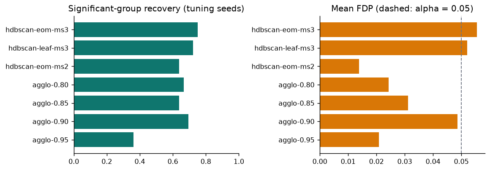
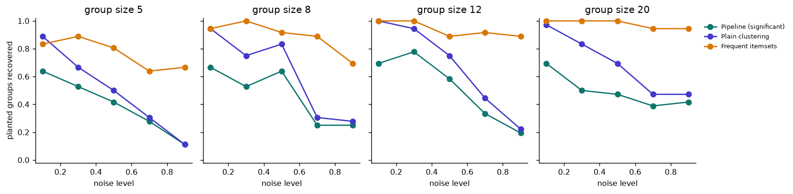
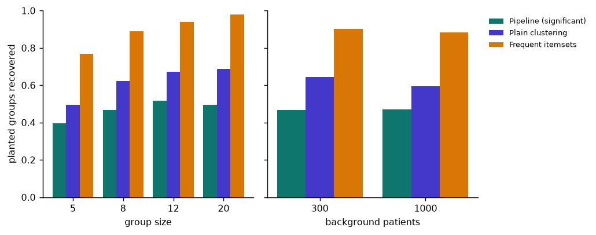
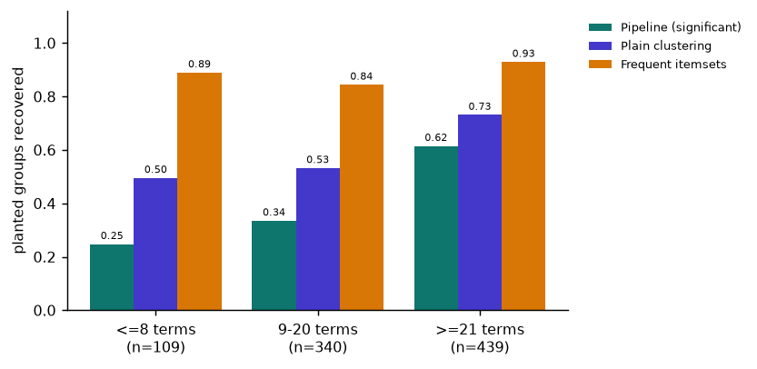
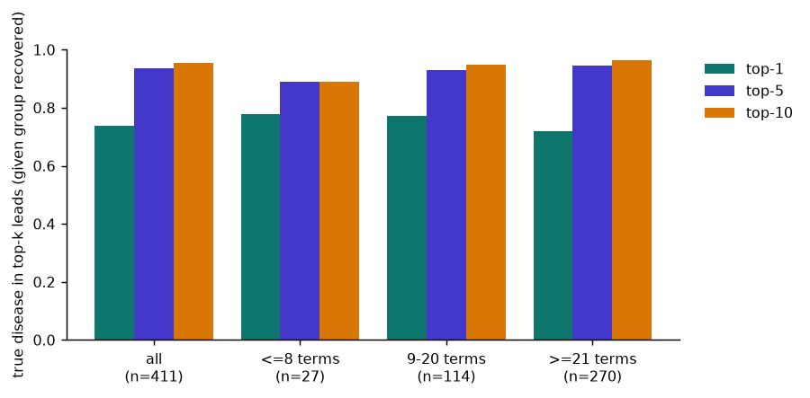
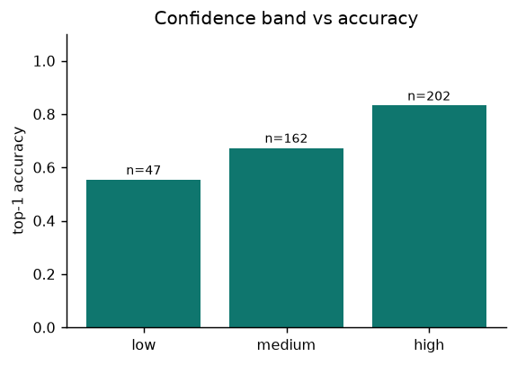
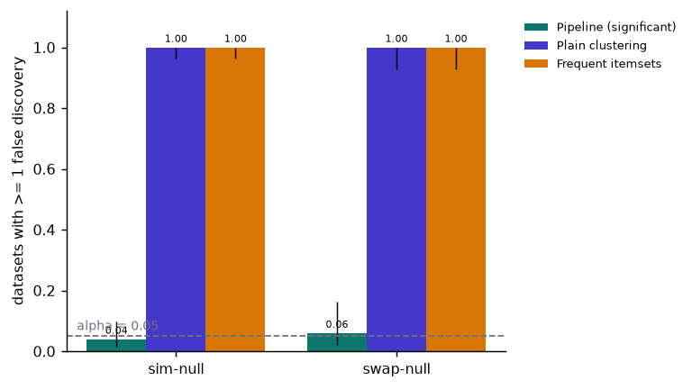
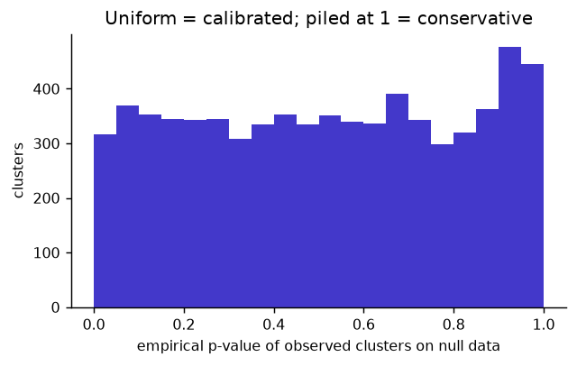
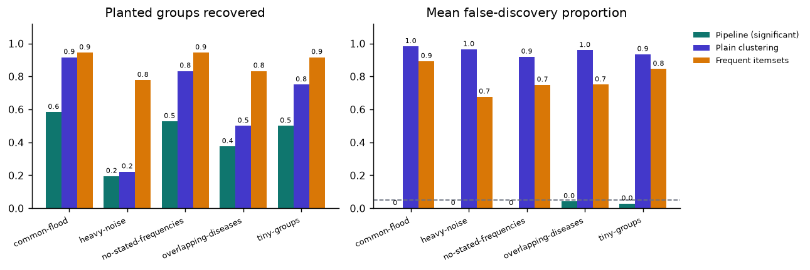
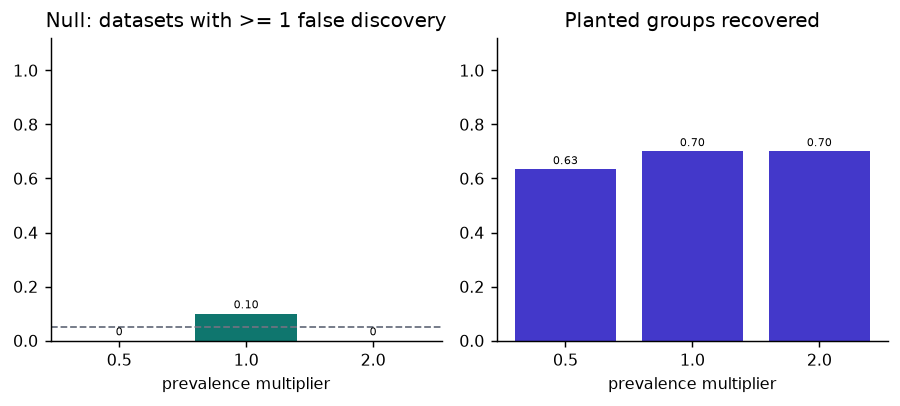

# PhenoPattern benchmark report

> **Research prototype. SIMULATED patients only.** Not medical advice; no clinical validity is claimed.

- Data: **HPO hp/releases/2026-09-01**  |  preset: **full**  |  permutations per run: **100**  |  commit: `491dc2d`
- Runs: 510 datasets (0 errors)  |  wall time 0.0 min on 1 worker(s)  |  2026-10-29

## 1. Headlines (generated from the numbers below)

- On **sim-null** datasets (no real pattern exists), the full pipeline reported at least one pattern in 4% [2%-10%] of datasets; plain clustering in 100% [96%-100%]; frequent itemsets in 100% [96%-100%]. Target for the pipeline: at most alpha = 0.05.
- On **swap-null** datasets (no real pattern exists), the full pipeline reported at least one pattern in 6% [2%-16%] of datasets; plain clustering in 100% [93%-100%]; frequent itemsets in 100% [93%-100%]. Target for the pipeline: at most alpha = 0.05.
- Recall across the grid: pipeline 47%, plain clustering 62%, itemsets 89%. The significance test costs 15 points of recall relative to plain clustering (it can only remove clusters, never add them).
- Mean false-discovery proportion in planted datasets: pipeline 0.01, plain clustering 0.93, itemsets 0.66 (target for the pipeline: <= 0.05).
- Recovery depends strongly on how many terms describe the disease: the pipeline recovered 25% of groups for diseases with <=8 terms (n=109) versus 62% for >=21 terms (n=439).
- Of the 145 planted groups that clustering found but the test did not call significant, 47 (32%) were near misses (q <= 0.20); median q = 0.35.
- **Mixed clusters** (mostly planted patients, but from different groups merged together): 1% of the pipeline's significant clusters in the grid. These are not false discoveries (the patients really are unusual) but the grouping is wrong.
- In the **common-symptom flood** (a large background of patients with only common symptoms, plus a few planted groups), mean FDP was pipeline 0.00, plain clustering 0.98, itemsets 0.89; mean patterns flagged per dataset: pipeline 1.8, plain clustering 154.1, itemsets 439.4.
- Scenarios where the itemset baseline recovered MORE planted groups than the pipeline: common-flood, heavy-noise, no-stated-frequencies, overlapping-diseases, tiny-groups (note its false-discovery proportion in the same scenarios).
- Runtime per dataset (mean 847 patients): pipeline 14.4 s (includes 100 permutations), itemsets 0.08 s.

## 2. Design and definitions

- **Recovered group:** a planted group has a flagged set with Jaccard > 0.5 (strict: a perfect merge of two equal groups scores exactly 0.5 and is not recovery). **Discovered** = found by clustering (before testing); **significant** = found AND passed FDR (q <= 0.05).
- **False discovery:** a flagged set where < 50% of members belong to ANY planted group, i.e. a chance pattern made of background patients (on null data, every flagged set).
- **Mixed cluster:** >= 50% planted members but at most 50% from one group (e.g. two diseases merged). Not a false discovery, but a wrong grouping; reported separately.
- **FDP / FDR:** false discoveries / flagged sets; FDR = mean FDP. Under a pure null, FDR equals P(at least one pattern flagged).
- **Seeds:** tuning seeds 1000+, grid 2000+, null 3000+, hard cases 4000+, sensitivity 5000+. Settings are chosen on tuning seeds only. Intervals are Wilson 95%; groups within one dataset are not independent, so treat them as indicative.
- **ARI/NMI** are computed over all patients with 'background/unclustered' as one class; background dominates, so group recovery is the headline.

## 3. Discovery-method tuning (tuning seeds only)

| config | datasets | groups | significant recovery | discovery recovery | mean FDP |
|---|---|---|---|---|---|
| hdbscan-eom-ms3 | 24 | 36 | 75% | 89% | 0.056 |
| hdbscan-leaf-ms3 | 24 | 36 | 72% | 89% | 0.052 |
| hdbscan-eom-ms2 | 24 | 36 | 64% | 97% | 0.014 |
| agglo-0.80 | 24 | 36 | 67% | 86% | 0.024 |
| agglo-0.85 | 24 | 36 | 64% | 94% | 0.031 |
| agglo-0.90 | 24 | 36 | 69% | 89% | 0.049 |
| agglo-0.95 | 24 | 36 | 36% | 47% | 0.021 |

**Chosen: `hdbscan-eom-ms3`**  (highest significant recovery among configs with mean FDP <= 0.10). Used unchanged for everything below.

## 4. Cluster recovery vs planted groups (noise x group size x background size)

| noise | group size | background | datasets | discovered | significant | itemsets (a) | ARI | NMI | FDP (pipeline) |
|---|---|---|---|---|---|---|---|---|---|
| 0.1 | 5 | 300 | 6 | 83% [61%-94%] | 61% [39%-80%] | 78% [55%-91%] | 0.80 | 0.79 | 0.000 |
| 0.1 | 5 | 1000 | 6 | 94% [74%-99%] | 67% [44%-84%] | 89% [67%-97%] | 0.78 | 0.78 | 0.000 |
| 0.1 | 8 | 300 | 6 | 94% [74%-99%] | 67% [44%-84%] | 94% [74%-99%] | 0.75 | 0.75 | 0.000 |
| 0.1 | 8 | 1000 | 6 | 94% [74%-99%] | 67% [44%-84%] | 94% [74%-99%] | 0.75 | 0.74 | 0.000 |
| 0.1 | 12 | 300 | 6 | 100% [82%-100%] | 61% [39%-80%] | 100% [82%-100%] | 0.69 | 0.72 | 0.000 |
| 0.1 | 12 | 1000 | 6 | 100% [82%-100%] | 78% [55%-91%] | 100% [82%-100%] | 0.85 | 0.85 | 0.000 |
| 0.1 | 20 | 300 | 6 | 94% [74%-99%] | 61% [39%-80%] | 100% [82%-100%] | 0.70 | 0.73 | 0.000 |
| 0.1 | 20 | 1000 | 6 | 100% [82%-100%] | 78% [55%-91%] | 100% [82%-100%] | 0.84 | 0.84 | 0.000 |
| 0.3 | 5 | 300 | 6 | 89% [67%-97%] | 67% [44%-84%] | 89% [67%-97%] | 0.79 | 0.78 | 0.000 |
| 0.3 | 5 | 1000 | 6 | 44% [25%-66%] | 39% [20%-61%] | 89% [67%-97%] | 0.58 | 0.57 | 0.000 |
| 0.3 | 8 | 300 | 6 | 78% [55%-91%] | 56% [34%-75%] | 100% [82%-100%] | 0.64 | 0.64 | 0.000 |
| 0.3 | 8 | 1000 | 6 | 72% [49%-88%] | 50% [29%-71%] | 100% [82%-100%] | 0.54 | 0.52 | 0.000 |
| 0.3 | 12 | 300 | 6 | 89% [67%-97%] | 83% [61%-94%] | 100% [82%-100%] | 0.84 | 0.83 | 0.000 |
| 0.3 | 12 | 1000 | 6 | 100% [82%-100%] | 72% [49%-88%] | 100% [82%-100%] | 0.77 | 0.75 | 0.000 |
| 0.3 | 20 | 300 | 6 | 83% [61%-94%] | 50% [29%-71%] | 100% [82%-100%] | 0.59 | 0.65 | 0.000 |
| 0.3 | 20 | 1000 | 6 | 83% [61%-94%] | 50% [29%-71%] | 100% [82%-100%] | 0.63 | 0.64 | 0.000 |
| 0.5 | 5 | 300 | 6 | 56% [34%-75%] | 44% [25%-66%] | 83% [61%-94%] | 0.74 | 0.72 | 0.000 |
| 0.5 | 5 | 1000 | 6 | 44% [25%-66%] | 39% [20%-61%] | 78% [55%-91%] | 0.50 | 0.50 | 0.000 |
| 0.5 | 8 | 300 | 6 | 83% [61%-94%] | 61% [39%-80%] | 94% [74%-99%] | 0.66 | 0.65 | 0.000 |
| 0.5 | 8 | 1000 | 6 | 83% [61%-94%] | 67% [44%-84%] | 89% [67%-97%] | 0.71 | 0.68 | 0.000 |
| 0.5 | 12 | 300 | 6 | 89% [67%-97%] | 56% [34%-75%] | 89% [67%-97%] | 0.62 | 0.64 | 0.000 |
| 0.5 | 12 | 1000 | 6 | 61% [39%-80%] | 61% [39%-80%] | 89% [67%-97%] | 0.71 | 0.68 | 0.000 |
| 0.5 | 20 | 300 | 6 | 72% [49%-88%] | 39% [20%-61%] | 100% [82%-100%] | 0.46 | 0.49 | 0.000 |
| 0.5 | 20 | 1000 | 6 | 67% [44%-84%] | 56% [34%-75%] | 100% [82%-100%] | 0.62 | 0.60 | 0.000 |
| 0.7 | 5 | 300 | 6 | 28% [12%-51%] | 22% [9%-45%] | 61% [39%-80%] | 0.26 | 0.27 | 0.083 |
| 0.7 | 5 | 1000 | 6 | 33% [16%-56%] | 33% [16%-56%] | 67% [44%-84%] | 0.52 | 0.51 | 0.139 |
| 0.7 | 8 | 300 | 6 | 33% [16%-56%] | 33% [16%-56%] | 94% [74%-99%] | 0.41 | 0.41 | 0.000 |
| 0.7 | 8 | 1000 | 6 | 28% [12%-51%] | 17% [6%-39%] | 83% [61%-94%] | 0.20 | 0.21 | 0.083 |
| 0.7 | 12 | 300 | 6 | 50% [29%-71%] | 39% [20%-61%] | 83% [61%-94%] | 0.48 | 0.47 | 0.000 |
| 0.7 | 12 | 1000 | 6 | 39% [20%-61%] | 28% [12%-51%] | 100% [82%-100%] | 0.41 | 0.39 | 0.000 |
| 0.7 | 20 | 300 | 6 | 50% [29%-71%] | 33% [16%-56%] | 100% [82%-100%] | 0.50 | 0.52 | 0.000 |
| 0.7 | 20 | 1000 | 6 | 44% [25%-66%] | 44% [25%-66%] | 89% [67%-97%] | 0.46 | 0.41 | 0.056 |
| 0.9 | 5 | 300 | 6 | 0% [0%-18%] | 0% [0%-18%] | 67% [44%-84%] | 0.00 | 0.00 | 0.000 |
| 0.9 | 5 | 1000 | 6 | 22% [9%-45%] | 22% [9%-45%] | 67% [44%-84%] | 0.33 | 0.33 | 0.000 |
| 0.9 | 8 | 300 | 6 | 33% [16%-56%] | 33% [16%-56%] | 89% [67%-97%] | 0.37 | 0.35 | 0.000 |
| 0.9 | 8 | 1000 | 6 | 22% [9%-45%] | 17% [6%-39%] | 50% [29%-71%] | 0.21 | 0.18 | 0.167 |
| 0.9 | 12 | 300 | 6 | 28% [12%-51%] | 22% [9%-45%] | 89% [67%-97%] | 0.34 | 0.32 | 0.000 |
| 0.9 | 12 | 1000 | 6 | 17% [6%-39%] | 17% [6%-39%] | 89% [67%-97%] | 0.34 | 0.31 | 0.000 |
| 0.9 | 20 | 300 | 6 | 56% [34%-75%] | 44% [25%-66%] | 94% [74%-99%] | 0.54 | 0.52 | 0.000 |
| 0.9 | 20 | 1000 | 6 | 39% [20%-61%] | 39% [20%-61%] | 94% [74%-99%] | 0.47 | 0.45 | 0.000 |

### 4b. Found by clustering but not significant: how close were they?

145 planted groups (grid + hard cases) were discovered but not significant. q-value of the best-matching discovered cluster (median q = 0.35, median effect z = 2.6):

| q-value of the cluster | groups |
|---|---|
| q <= 0.10 | 22 |
| 0.10 < q <= 0.20 | 25 |
| 0.20 < q <= 0.50 | 36 |
| q > 0.50 | 62 |

_Many near misses would point to limited statistical power (for example from testing many tiny background clusters); mostly large q-values would point to genuinely weak signal._

### 4c. Recovery by disease profile (grid + hard cases)

_Which diseases are detectable at all? Splits by how many HPO terms annotate the disease, its source, and whether annotation frequencies are stated._

| split | groups | pipeline (significant) | plain clustering | itemsets (a) |
|---|---|---|---|---|
| profile size: <=8 terms | 109 | 25% [18%-34%] | 50% [40%-59%] | 89% [82%-94%] |
| profile size: 9-20 terms | 340 | 34% [29%-39%] | 53% [48%-58%] | 84% [80%-88%] |
| profile size: >=21 terms | 439 | 62% [57%-66%] | 73% [69%-77%] | 93% [90%-95%] |
| source: OMIM | 555 | 50% [46%-54%] | 65% [61%-69%] | 91% [88%-93%] |
| source: ORPHA | 333 | 40% [35%-45%] | 58% [53%-63%] | 86% [82%-89%] |
| stated frequencies: none stated | 106 | 38% [29%-47%] | 64% [55%-73%] | 85% [77%-90%] |
| stated frequencies: some/all stated | 782 | 47% [44%-51%] | 62% [59%-66%] | 90% [87%-92%] |

## 5. Disease-lead accuracy (grid + hard-case groups)

_Leads are only produced for significant clusters. 'Given recovered' conditions on the group having been found; 'overall' counts a missed group as a miss. Leads are possible leads from published annotations, not diagnoses._

| split | groups | recovered | top-1 (given recovered) | top-5 (given recovered) | top-10 (given recovered) | top-1 (overall) |
|---|---|---|---|---|---|---|
| all groups | 888 | 411 | 74% [69%-78%] | 94% [91%-96%] | 95% [93%-97%] | 34% [31%-37%] |
| profile size: <=8 terms | 109 | 27 | 78% [59%-89%] | 89% [72%-96%] | 89% [72%-96%] | 19% [13%-28%] |
| profile size: 9-20 terms | 340 | 114 | 77% [69%-84%] | 93% [87%-96%] | 95% [89%-98%] | 26% [22%-31%] |
| profile size: >=21 terms | 439 | 270 | 72% [66%-77%] | 94% [91%-97%] | 96% [93%-98%] | 44% [40%-49%] |
| source: OMIM | 555 | 279 | 76% [71%-81%] | 95% [92%-97%] | 96% [93%-98%] | 38% [34%-42%] |
| source: ORPHA | 333 | 132 | 69% [61%-76%] | 90% [84%-94%] | 94% [88%-97%] | 27% [23%-32%] |
| stated frequencies: none stated | 106 | 40 | 68% [52%-80%] | 90% [77%-96%] | 92% [80%-97%] | 25% [18%-35%] |
| stated frequencies: some/all stated | 782 | 371 | 74% [70%-79%] | 94% [91%-96%] | 96% [93%-97%] | 35% [32%-39%] |

**Are the confidence bands calibrated?** (top-1 accuracy by band, recovered groups only)

| band | n | top-1 | top-5 |
|---|---|---|---|
| low | 47 | 55% [41%-69%] | 85% [72%-93%] |
| medium | 162 | 67% [60%-74%] | 89% [83%-93%] |
| high | 202 | 83% [77%-88%] | 100% [97%-100%] |

## 6. False discoveries on null datasets (no planted groups)

Under a pure null every flagged pattern is false, so FDR = P(at least one pattern flagged). Target for the pipeline: <= 0.05.

| null type | datasets | pipeline: any flagged | plain clustering: any flagged | itemsets: any flagged | mean flagged (pipe / plain / items) |
|---|---|---|---|---|---|
| sim-null | 100 | 4% [2%-10%] | 100% [96%-100%] | 100% [96%-100%] | 0.0 / 46.1 / 264.8 |
| swap-null | 50 | 6% [2%-16%] | 100% [93%-100%] | 100% [93%-100%] | 0.1 / 49.1 / 518.7 |

`sim-null`: simulator null mode (independent common symptoms). `swap-null`: swap-randomised copies of a planted cohort (true draws from the null model with heterogeneous patient degrees).

## 7. Hard cases

| scenario | datasets | groups | pipeline recovery | plain clustering | itemsets (a) | FDP pipe / plain / items | mixed clusters pipe / plain / items | merged: cluster holds >= half of both groups (overlap only) |
|---|---|---|---|---|---|---|---|---|
| common-flood | 12 | 36 | 58% [42%-73%] | 92% [78%-97%] | 94% [82%-98%] | 0.00 / 0.98 / 0.89 | 0.00 / 0.00 / 0.03 | - |
| heavy-noise | 12 | 36 | 19% [10%-35%] | 22% [12%-38%] | 78% [62%-88%] | 0.00 / 0.96 / 0.68 | 0.00 / 0.00 / 0.20 | - |
| no-stated-frequencies | 12 | 36 | 53% [37%-68%] | 83% [68%-92%] | 94% [82%-98%] | 0.00 / 0.92 / 0.75 | 0.00 / 0.00 / 0.10 | - |
| overlapping-diseases | 12 | 24 | 38% [21%-57%] | 50% [31%-69%] | 83% [64%-93%] | 0.04 / 0.96 / 0.75 | 0.29 / 0.01 / 0.10 | 56% [34%-75%] |
| tiny-groups | 12 | 36 | 50% [34%-66%] | 75% [59%-86%] | 92% [78%-97%] | 0.03 / 0.93 / 0.85 | 0.00 / 0.00 / 0.09 | - |

## 8. Sensitivity to assumed common-symptom prevalences

All common-symptom prevalences multiplied by the factor (capped at 0.6).

| prevalence x | null datasets | pipeline: any flagged (null) | planted groups | pipeline recovery | mean FDP (planted) |
|---|---|---|---|---|---|
| 0.5 | 10 | 0% [0%-28%] | 30 | 63% [46%-78%] | 0.033 |
| 1.0 | 10 | 10% [2%-40%] | 30 | 70% [52%-83%] | 0.000 |
| 2.0 | 10 | 0% [0%-28%] | 30 | 70% [52%-83%] | 0.000 |

## 9. Runtime

Mean detection run (100 permutations, ~847 patients, one core): 14.4 s. Itemset baseline: 0.08 s. Plain clustering costs the discovery step only (a small fraction of the pipeline).

## 10. Limitations (read these)

- **Simulated data only.** Every patient is synthetic. Results say nothing about clinical validity or real-patient performance.
- **The simulator is my model of the world.** Common-symptom prevalences, the default annotation frequency (0.5), independence of
  common symptoms and the noise model are assumptions. The prevalence sensitivity run varies only one of them.
- **The null model keeps symptom frequencies and patient symptom counts, not correlations between common symptoms.** The simulator draws
  common symptoms independently, so this benchmark cannot show what happens with real comorbidities; the pipeline could flag them.
- **Planted difficulty varies a lot by disease** (profile size, stated frequencies). Averages hide that; see the splits.
- **False-discovery estimates have wide confidence intervals** at these sample sizes; "0 of n" only bounds the rate (rule of three: about 3/n).
- **Two similar diseases can merge into one cluster**, and loose groups (each patient shows a different slice) are hard to find.
- **The methods flag very different numbers of patterns** (see "mean flagged"), so recall alone is not comparable between them. Read recall
  and false-discovery proportion together, as a pair; the itemset baseline can reach high recall precisely because it flags so many patterns.
- **Baselines are simple versions.** Itemsets: pairs only, top 3000 patterns by support, greedy merging. A stronger baseline (more
  tuning, larger itemsets, post-hoc filters) might do better; this one is deliberately naive.
- **Disease-lead accuracy is optimistic by construction (circular).** Planted patients are simulated from the same HPO annotations that the
  leads are ranked against, so top-k accuracy measures agreement with the annotation source, not diagnostic performance on real patients,
  whose symptoms deviate from published profiles in ways this simulator does not model.
- **Confidence bands for disease leads are heuristic.** The calibration table shows whether they track accuracy here; it does not
  validate them on real patients.
- **Defaults were tuned on a small grid of discovery settings** using tuning seeds; held-out seeds are reported, but both use the same simulator.
  Tuning cohorts included flood-type cohorts (an earlier attempt without them picked a setting that merged groups in a flood), so the
  "common-flood" hard case uses unseen seeds but is not a held-out scenario type.
